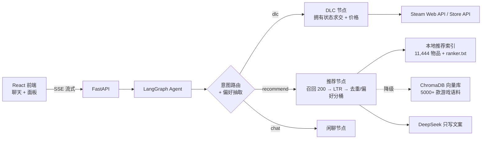

# SteamAssistant 🎮

AI 游戏助手 Agent

读取你的 Steam 游戏库,整理已拥有游戏的 DLC 信息,并根据你的游戏库做定制化游戏推荐
(本地**混合推荐**:多路召回 + LightGBM 精排,零推理;支持多轮追问与偏好累积)。

## 技术栈

| 层 | 技术 |
|---|---|
| 前端 | React + Vite + TypeScript |
| 后端 | FastAPI |
| Agent | LangGraph(意图路由 → DLC / 推荐 / 游戏评测 / 闲聊) |
| 推荐 | 多路召回 + LightGBM LTR(离线预计算,在线纯查表) |
| RAG | ChromaDB + sentence-transformers(本地 embedding,推荐降级兜底) |
| LLM | DeepSeek(`deepseek-flash`) |

## 架构



## 目录结构

```
SteamAssistant/
├─ frontend/          # React + Vite
│  └─ src/components/ # Chat / Library / Dlc / Card
├─ backend/
│  ├─ app/
│  │  ├─ main.py      # FastAPI 入口 + CORS
│  │  ├─ routers/     # library / dlc / chat(SSE)
│  │  ├─ agent/       # LangGraph 图、提示词、流式
│  │  ├─ rag/         # embedder + ChromaDB 检索
│  │  └─ steam/       # API 客户端、导入、DLC 计算
│  ├─ scripts/        # build_corpus.py / build_index.py
│  ├─ tests/          # 离线单测 + 手工联调脚本
│  ├─ data/           # 语料 + 向量库(已 gitignore,需本地构建)
│  └─ .env.example
├─ docs/
│  ├─ PROJECT.md      # 现状:架构、模块详解、API、踩坑
│  └─ ROADMAP.md      # 深化路线图:清理清单、Phase 0、方向 A/B
└─ README.md
```

## 快速开始

### 0. 准备

- Python 3.11+、Node.js 20+
- 申请 [DeepSeek API key](https://platform.deepseek.com)
- 申请 [Steamworks Web API key](https://steamcommunity.com/dev/apikey)(登录后填域名如 `localhost` 即可)
- Steam 设置 → 隐私 → 「游戏详情」设为**公开**(否则读不到库)

### 1. 后端

```bash
cd backend
python -m venv .venv
# Windows: .venv\Scripts\activate   macOS/Linux: source .venv/bin/activate
pip install -r requirements.txt        # 慢的话加 -i https://pypi.tuna.tsinghua.edu.cn/simple
cp .env.example .env                   # 填入真实 key
```

编辑 `backend/.env`:

```env
DEEPSEEK_API_KEY=sk-xxxx
STEAM_API_KEY=xxxx
STEAM_ID=7656119xxxxxxxxxx            # 可选
STEAM_PROXY=http://127.0.0.1:12450    # 国内访问 Steam 的本地代理,无则留空
STEAM_RATE_LIMIT=10                   # Steam 请求限速(每秒请求数)
HF_ENDPOINT=https://hf-mirror.com     # 国内下载模型/数据集镜像
```

构建 RAG 语料与向量索引(一次性,约几分钟):

```bash
python scripts/build_corpus.py   # 下载数据集(192MB) -> data/corpus.jsonl(5362 条)
python scripts/build_index.py    # 嵌入 -> data/chroma
```

启动:

```bash
uvicorn app.main:app --reload
# Swagger: http://127.0.0.1:8000/docs
```

### 2. 前端

```bash
cd frontend
npm run dev
# http://localhost:5173 (已配置 /api 代理到 8000)
```

## 功能说明

- **游戏库导入**:SteamID 导入(需 key + 资料公开),内置获取 SteamID 引导弹窗
- **DLC 整理**:列出每款游戏的已拥有 / 未拥有 DLC 与价格;追问可展开某游戏的完整列表
- **游戏推荐**:本地**混合推荐**(5 路召回 + LightGBM 精排)→ LLM 生成个性化理由,卡片内联展示(最多 5 个)。
  在线纯查表 + 点积,**不跑 embedding 推理、不调 Steam**,实测 P50 9ms
- **多轮推荐**:说「换一批」不会重复上一批,说「我更喜欢策略类的」会真的按类型重排,
  偏好逐轮累积;实在没有符合的会**如实说**并给替代方案(而不是硬凑)
- **游戏评测**:问「某游戏怎么样」→ 卡片 + 详细介绍(引用真实玩家评价)+ 与你的偏好匹配分析
- **流式输出**:聊天中实时展示 agent 中间步骤与 token 流

### 推荐算法(方向 A)

| 指标 | 改造前(多查询 RAG) | 改造后(混合召回 + LTR) |
|---|---|---|
| recall@10 | 0.80% | **24.00%** |
| NDCG@10 | 0.0031 | **0.1430** |
| 在线延迟 P50 | 需跑一次 embedding 推理 | **9.1 ms**(多轮约束 +0.24ms) |
| 是否需 GPU | 否(CPU 跑 embedding) | 否(零推理) |

离线资产(73 MB,`backend/data/recommend/`):11,444 物品目录 + 内容向量 + 两路 TopK 邻居
+ 用户画像向量 + 交互稀疏矩阵 + LightGBM 排序模型。完整的消融、协议设计与踩坑记录见
[docs/RECOMMENDER.md](docs/RECOMMENDER.md)。

## 注意事项

- `backend/data/`(语料、向量库、推荐索引)已 gitignore,clone 后需重新构建:
  `build_corpus.py` → `build_index.py` → `build_interactions.py` → `build_recommend_index.py` → `train_ranker.py`
- 本地推荐索引冷加载约 0.9s,应用启动时已预热(`lifespan`);
  **索引缺失时推荐节点会自动退回原来的 RAG 路径**,服务不会起不来
- 首次「推荐游戏」请求若走 RAG 降级路径,会加载本地 embedding 模型(约 10~20s)

## 文档与路线图

- 现状文档见 [docs/PROJECT.md](docs/PROJECT.md)(架构、模块详解、API、踩坑)
- **推荐算法实现全记录见 [docs/RECOMMENDER.md](docs/RECOMMENDER.md)**(数据 / 离线索引 / 评测协议 /
  召回 / LTR 排序 / 在线服务 / 消融 / **多轮对话** / **已知局限与 21 条可优化点**)
- 深化计划见 [docs/ROADMAP.md](docs/ROADMAP.md):方向 A(推荐算法)已 ✅ 完成;
  下一步是方向 B —— 以「本地 LLM 推理服务 + 调优」(AI Infra)为主干
